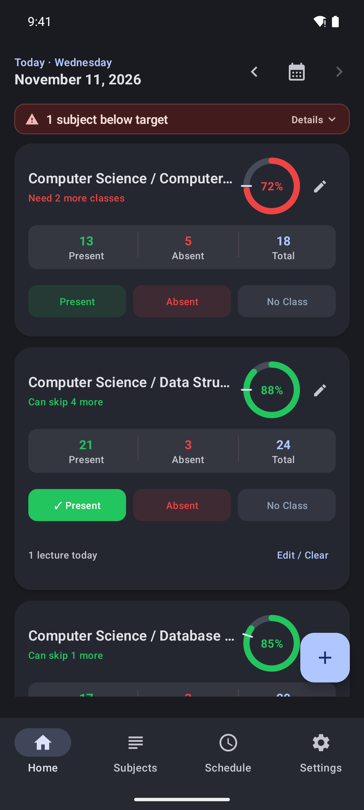
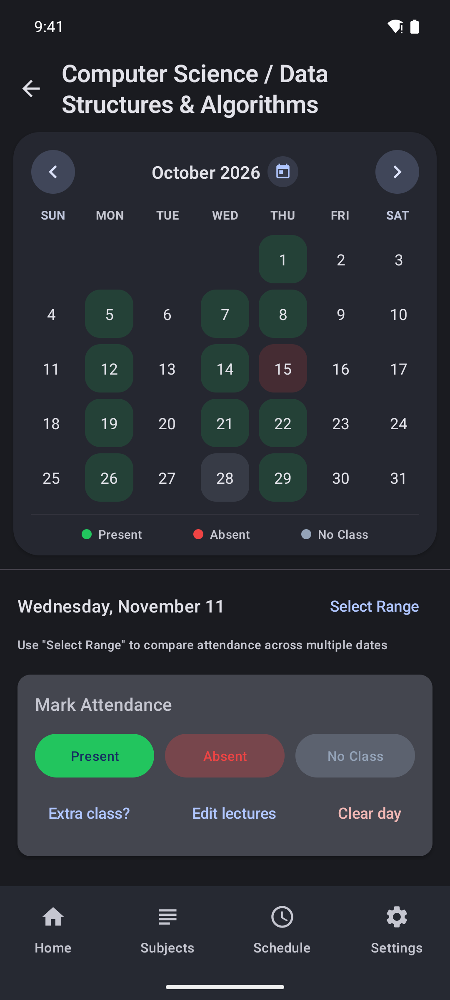
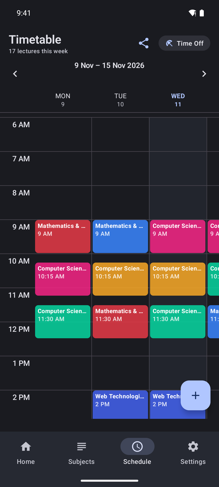
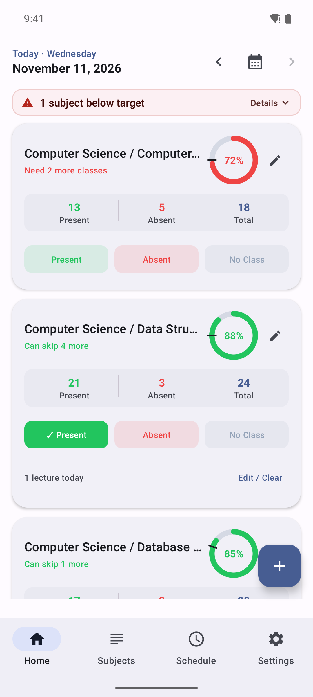
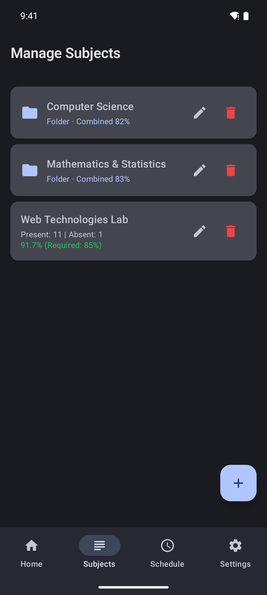
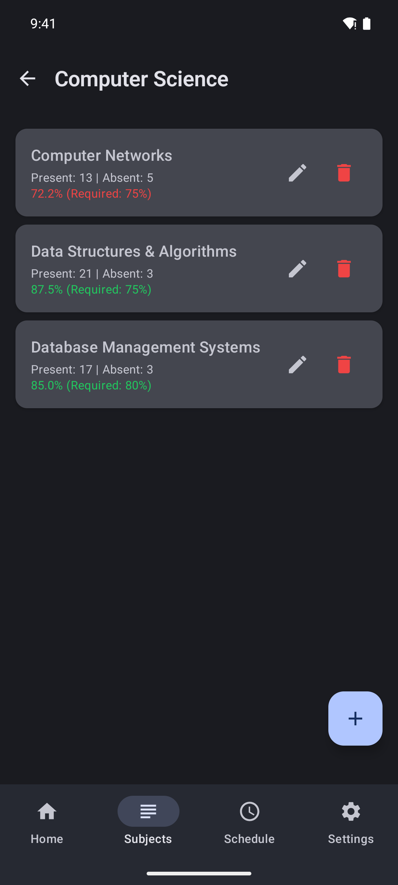
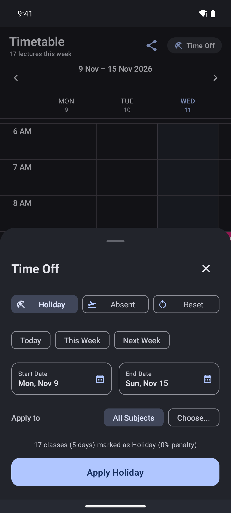
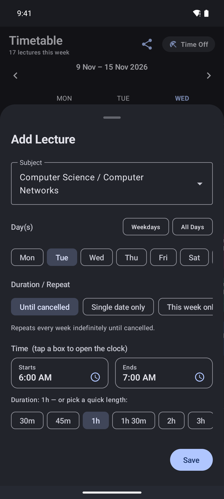
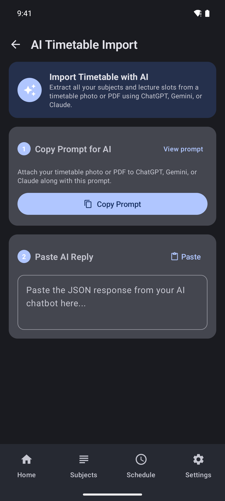
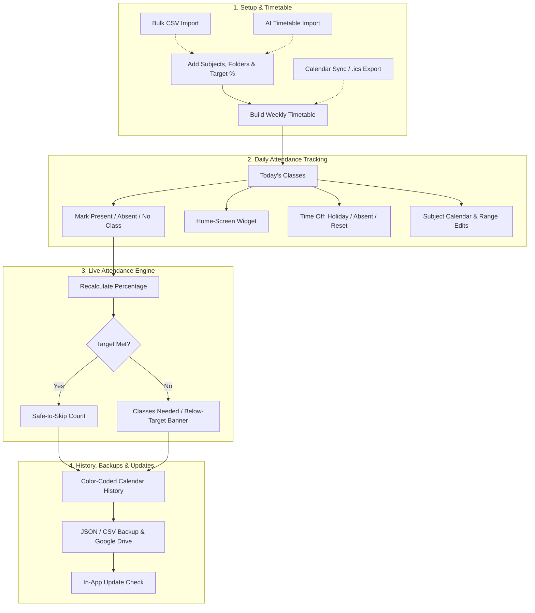

<div align="center">

# 🎓 Attendance Tracker

**A native Android app for tracking class attendance, hitting your target percentage, and knowing exactly when you can skip a lecture.**

[](https://github.com/hrishikeshp7/Self-Attendance-Tracker/actions/workflows/build.yml)
[](https://kotlinlang.org/)
[](https://developer.android.com/jetpack/compose)
[](https://m3.material.io/)
[](https://www.gnu.org/licenses/agpl-3.0.html)

*Built with Kotlin, Jetpack Compose, Room, and Material 3. Entirely vibe-coded with AI as a test project.*

<br />

<p align="center">
  
  &nbsp;
  
  &nbsp;
  
</p>

</div>

<br />

## 🌟 Overview

Attendance Tracker keeps a per-lecture record of your attendance and turns it into a clear answer: how many classes you can still skip, or how many you must attend to get back above your target. It supports weekly timetables with real date ranges, multiple lectures per day, folders, holidays and leave, home-screen marking, calendar export, and local or Google Drive backups.

---

## 📱 Screenshots

<div align="center">

### Daily Dashboard & Tracking
| Today's Dashboard (Dark) | Today's Dashboard (Light) | Subject Calendar & History |
| :---: | :---: | :---: |
|  |  |  |

### Timetable & Organization
| Weekly Timetable | Subject & Folder Hierarchy | Inside Subject Folder |
| :---: | :---: | :---: |
|  |  |  |

### Smart Tools & Setup
| Time Off & Vacation Modes | Add / Edit Lecture Slot | AI Timetable Import |
| :---: | :---: | :---: |
|  |  |  |

</div>

---

## 🚀 How It Works



1. **Setup & Timetable**: add subjects (optionally inside folders), set individual target percentages, then build a weekly timetable by hand, import it from CSV, or convert a timetable photo/PDF with AI. Timetable slots can repeat weekly or be limited to a date range.
2. **Flexible Daily Tracking**: mark Present, Absent, or No Class from Home or the home-screen widget. Mark individual lectures on multi-lecture days, add extra classes, and apply Time Off for holidays, leave, or a full reset across a date range.
3. **Smart Calculations**: each subject instantly shows its percentage, how many classes can be skipped safely, or how many consecutive classes are needed to recover. A collapsible banner highlights every subject below target.
4. **History & Backups**: review a color-coded calendar per subject, then protect your data with JSON/CSV exports, Google Drive backup, and restore. The app can also check GitHub Releases and install an update in place.

---

## ✨ Key Features

| Feature | Description |
| :--- | :--- |
| 📊 **Home Dashboard** | Today's scheduled classes with per-lecture Present / Absent / No Class entries, a collapsible below-target banner, and one-tap "Add Extra Class". |
| 📅 **Subject Calendar** | Monthly color-coded history (🟢 Present, 🔴 Absent, ⚫ No Class), range selection, extra classes, and exact present/absent counts per day. |
| 📚 **Subjects & Folders** | Create subjects or folders, move subjects into folders, and set a required attendance percentage per subject. |
| 🗓 **Weekly Timetable** | Multiple lectures per day, multi-day recurring slots, semester date ranges, one-off dated lectures, and quick editing or deletion of any slot. |
| 🏖 **Time Off** | Apply Holiday (no penalty), Absent (leave), or Reset across a date range to all subjects or only selected ones, with Today / This Week / Next Week presets. |
| 🧩 **Home-Screen Widget** | A resizable Glance widget showing today's classes with one-tap Present / Absent buttons. Refreshes automatically at midnight. |
| 🔔 **Notifications** | Daily reminder at a time you choose, a missed-mark alert listing unmarked classes, and an at-risk alert when a subject drops below target. |
| 📆 **Calendar Sync** | Write your timetable into an on-device calendar (Google Calendar, etc.) or export it as `.ics` for Notion Calendar, Outlook, or Apple Calendar. |
| 🤖 **AI Timetable Import** | Copy the built-in prompt into ChatGPT, Claude, or Gemini with a timetable photo/PDF, then paste the JSON reply back into the app. |
| 💾 **Backup & Import** | JSON backup/restore, CSV export, Google Drive backup via the system file picker, and CSV import with a preview before anything is saved. |
| 🎨 **Themes** | System, Light, Dark, and AMOLED modes, plus dynamic Material You colors on Android 12+. |
| 🔄 **In-App Updates** | Check GitHub Releases, download the newest APK, and hand it to the system installer from the About screen. |
| 👆 **Swipe Navigation** | Swipe left/right to move between weeks in the timetable and months in the calendar. |

### CSV import format

One row per lecture slot (or one row per subject). Header names are case-insensitive; `subject` is required.

```csv
subject,target_percentage,attended,total,day,start,end
Physics,75,20,25,Monday,09:00,10:00
Physics,,,,Wednesday,11:00,12:00
Chemistry,80,18,22,Tuesday,10:00,11:00
```

A template can be downloaded from **Backup & Restore → Import from CSV**.

---

## 🛠 Tech Stack

- **Language**: Kotlin 2.0.21
- **UI**: Jetpack Compose (Material 3), Navigation Compose
- **Architecture**: MVVM with Kotlin Flow and a single repository layer
- **Database**: Room (SQLite) with KSP
- **Widgets**: Jetpack Glance
- **Background work**: WorkManager
- **Build**: Android Gradle Plugin 8.13.2, Gradle 9.5.0, JDK 17
- **SDK**: min 26 (Android 8.0), compile/target 36 (Android 16)

---

## 🏗 Building the Project

### Prerequisites

- Android Studio (latest stable)
- JDK 17
- Android SDK 36

### Build & test

```bash
# Clone the repository
git clone https://github.com/hrishikeshp7/Self-Attendance-Tracker.git
cd Self-Attendance-Tracker

# Debug build
./gradlew assembleDebug

# Unit tests
./gradlew test
```

`versionName` and `versionCode` are derived from the Git commit count, so build from a full clone (CI uses `fetch-depth: 0`).

---

## 📂 Project Structure

```text
app/src/main/java/com/attendance/tracker/
├── backup/           # JSON backup, CSV import/export, AI timetable import
├── calendarsync/     # Device calendar sync and .ics export
├── data/
│   ├── database/     # Room DB, DAOs, type converters
│   ├── model/        # Subject, AttendanceRecord, ScheduleEntry, ThemePreference
│   ├── repository/   # Single source of truth for data access
│   ├── SlotAttendanceStore.kt   # Per-lecture status for a day
│   └── TimeOffStore.kt          # Stored Time Off rules and syncing
├── notification/     # Daily reminder, missed-mark and at-risk notifications
├── ui/
│   ├── components/   # SubjectCard, CalendarView, charts, Time Off sheet
│   ├── screens/      # Home, Subjects, Schedule, Calendar, Settings, Backup, AI Import, About
│   └── theme/        # Material 3 theme, colors, typography
├── update/           # GitHub release check and APK installer
├── widget/           # Glance Today widget
└── MainActivity.kt   # Entry point
```

Unit tests live under `app/src/test/` and cover the repository logic, Time Off rules, CSV/AI import, backups, `.ics` export, and date/schedule calculations.

---

## 📥 Download & Updates

Grab the latest signed APK from the [Releases page](https://github.com/hrishikeshp7/Self-Attendance-Tracker/releases). Once installed, use **Settings → About & Updates → Check for updates** to update in place.

---

## 📝 License & Author

Made with ❤️ by [hrishikeshp7](https://github.com/hrishikeshp7)

This project is licensed under the **GNU Affero General Public License v3.0 (AGPL-3.0)**. See [LICENSE](LICENSE) for the full text.
